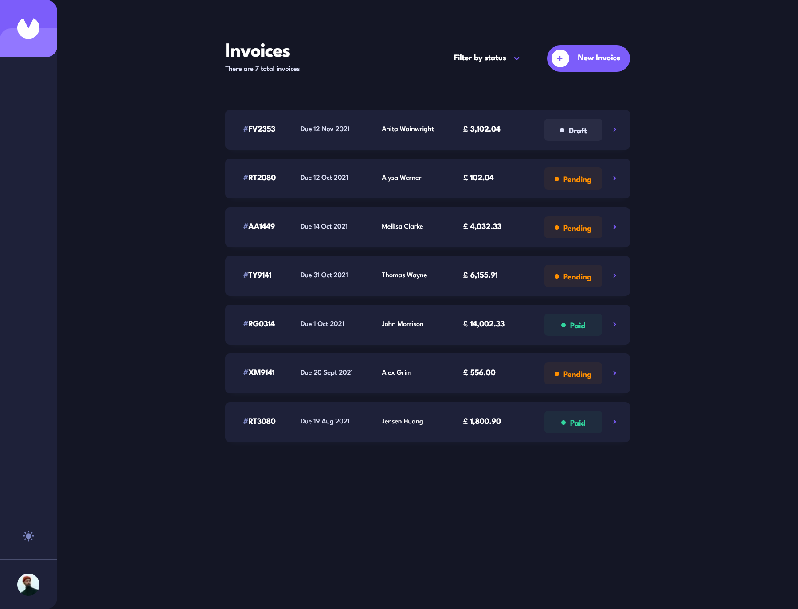
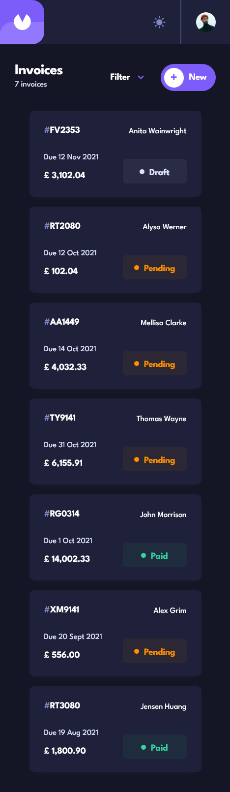

# Frontend Mentor - Invoice app solution

This is a solution to the [Invoice app challenge on Frontend Mentor](https://www.frontendmentor.io/challenges/invoice-app-i7KaLTQjl). Frontend Mentor challenges help you improve your coding skills by building realistic projects.

## Table of contents

- [Overview](#overview)
  - [The challenge](#the-challenge)
  - [Screenshot](#screenshot)
  - [Links](#links)
- [My process](#my-process)
  - [Built with](#built-with)
  - [What I learned](#what-i-learned)
  - [Continued development](#continued-development)
  - [Useful resources](#useful-resources)
- [Author](#author)

## Overview

### The challenge

Users should be able to:

- View the optimal layout for the app depending on their device's screen size
- See hover states for all interactive elements on the page
- Create, read, update, and delete invoices
- Receive form validations when trying to create/edit an invoice
- Save draft invoices, and mark pending invoices as paid
- Filter invoices by status (draft/pending/paid)
- Toggle light and dark mode
- **Bonus**: Keep track of any changes, even after refreshing the browser (`localStorage` or backend persistence via Supabase)

### Screenshot




### Links

- Solution URL: [Add solution URL here](https://your-solution-url.com)
- Live Site URL: [live site URL](https://invoice-app-amro.vercel.app/)

## My process

### Built with

- Semantic HTML5 markup
- Tailwind CSS (with custom CSS variables and `@theme` design tokens)
- Flexbox & CSS Grid (Mobile-first responsive architecture)
- [React](https://reactjs.org/) - JS library
- [Next.js](https://nextjs.org/) - React framework (App Router, Parallel & Intercepted Routes, Server Actions)
- [Supabase](https://supabase.com/) - Backend database and relational data services
- [React Hook Form](https://react-hook-form.com/) - Form state management, validation, and dynamic arrays

### What I learned

Working through this full-stack invoice application provided deep hands-on experience with advanced Next.js App Router patterns, robust accessibility (a11y) compliance, and complex form state synchronization.

Here are a few technical highlights and code snippets that stand out from the development process:

#### 1. Robust Focus Trapping with Responsive Element Filtering

To maintain strict accessibility compliance inside modals across varying viewports, I implemented a focus trap query filter that ignores elements hidden by CSS (such as mobile-only buttons) by evaluating `offsetParent`:

```js
const handleKeyDown = (e) => {
  if (e.key === "Tab") {
    const allFocusable = modalElement.querySelectorAll(focusableSelector);
    const focusableElements = Array.from(allFocusable).filter(
      (el) => el.offsetParent !== null,
    );

    if (focusableElements.length === 0) return;

    const firstElement = focusableElements[0];
    const lastElement = focusableElements[focusableElements.length - 1];

    if (e.shiftKey && document.activeElement === firstElement) {
      e.preventDefault();
      lastElement.focus();
    } else if (!e.shiftKey && document.activeElement === lastElement) {
      e.preventDefault();
      firstElement.focus();
    }
  }
};
```

#### 2. Dynamic Line-Item Management & Smart Keyboard Focus

Managing nested array inputs for invoice line items using React Hook Form's useFieldArray while ensuring accessible focus management upon item removal:

```js
const handleRemoveItem = (index) => {
  const noOfItems = fields.length;
  const nextFocusIndex = index < noOfItems - 1 ? index : index - 1;
  const newCount = noOfItems - 1;

  remove(index);

  requestAnimationFrame(() => {
    if (nextFocusIndex >= 0) {
      document.getElementById(`name-${nextFocusIndex}-id`)?.focus();
    } else {
      document.getElementById("add-item-btn")?.focus();
    }
  });
};
```

#### 3. Secure Server Actions with Supabase Integration

Implementing robust server-side mutations with validation guards, database synchronization, and path revalidation:

```js
export async function createNewInvoice(formData) {
  const transformedData = transformInvoiceFormData(formData);

  const { data, error } = await supabase
    .from("invoices")
    .insert([transformedData])
    .select();

  if (error) throw new Error(error.message);

  revalidatePath("/invoices");
  return { success: true, data };
}
```

### Continued development

- I want to start learning typescript and implement it inside here.

### Useful resources

- [Next.js App Router Documentation](https://nextjs.org/docs/app) - Crucial for understanding parallel/intercepted routing and server actions.
- [React Hook Form Documentation](https://react-hook-form.com/) - Essential for optimizing performance on dynamic form array states.

### Author

- Frontend Mentor - [@aemrobe](https://www.frontendmentor.io/profile/aemrobe)
